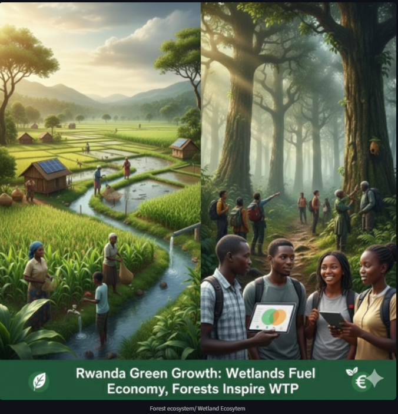

# 🌍 **Rwanda Wetland and Forest Data Analysis & Interactive Dashboard**

This project goes beyond traditional data analysis. It is an **automated data-cleaning, processing, analysis and visualization pipeline** developed to support the assessment of Rwanda's wetland and forest ecosystems.

It transforms raw environmental and household survey data into structured datasets, analytical outputs and interactive visualizations that make ecosystem valuation and research findings easier to explore.

- **Automated data cleaning:** Developed a Python-based pipeline to clean, validate, transform and prepare raw wetland and forest datasets, reducing manual data preparation.
- **Automated visualization:** Generated charts and visual summaries directly from processed data to communicate patterns and research findings.
- **Research-driven analysis:** Applied extensive research into Rwanda's wetland and forest ecosystems, incorporating the InVEST model from the Natural Capital Project to assess ecosystem services.
- **Interactive dashboard:** Deployed the application using Streamlit on Hugging Face Spaces, allowing users to explore the analytical outputs through a web browser.

### **Tools and technologies**

| Tool                | Application                                               |
| ------------------- | --------------------------------------------------------- |
| Excel               | Initial data handling and inspection                      |
| Python              | Data cleaning, processing and automation                  |
| InVEST 3.12.0       | Ecosystem service modelling and natural capital valuation |
| Streamlit           | Interactive dashboard development                         |
| Hugging Face Spaces | Cloud hosting and deployment                              |

### **Project deliverables**

1. An automated data-cleaning workflow for Rwanda's wetland and forest datasets.
2. Processed and structured data ready for research and analysis.
3. Visualizations that communicate environmental and ecosystem-related findings.
4. An interactive web application for exploring the outputs.
5. A research-oriented analytical framework supporting wetland and forest ecosystem valuation.

  

